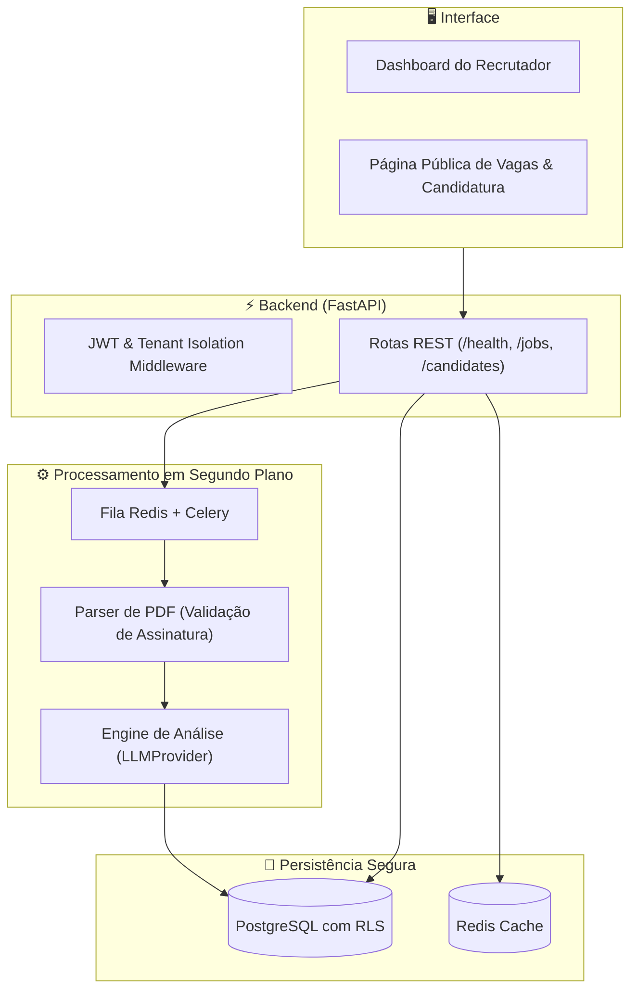

# 🚀 TalentFlow AI

> **SaaS Multi-inquilino de Recrutamento Inteligente (ATS) com Triagem Automatizada e Análise de Aderência por IA.**

[](https://github.com/talentflow-ai/talentflow-ai/actions)
[](LICENSE)
[](https://python.org)
[](https://fastapi.tiangolo.com)
[](https://github.com/astral-sh/ruff)
[](https://mypy-lang.org/)

---

## 💡 Sobre o Projeto

O **TalentFlow AI** é um sistema completo de gestão e triagem de candidatos (ATS) desenhado para empresas que precisam otimizar o tempo de seleção sem perder a precisão e a equidade no processo.

### Principais Pilares:
- **Isolamento Estrito de Tenants:** Cada empresa cliente possui seus dados totalmente segregados no banco de dados via `tenant_id` e políticas de Row-Level Security (RLS).
- **IA Ética e Supervisionada:** A IA analisa currículos, calcula pontuações de aderência com base em evidências verificáveis (citações literais) e recomenda. **A decisão final de reprovação ou avanço de etapa é sempre humana.**
- **Engenharia de Privacidade (LGPD):** Separação entre dados pessoais do candidato e dados de candidatura, anonimização, retenção configurável e portal do titular (Art. 18).
- **Resiliência e Desempenho:** Processamento de PDFs e inferências de IA desacoplados em workers assíncronos (Celery + Redis).

> 🤖 **Transparência de Desenvolvimento:** Este projeto foi implementado utilizando agentes de inteligência artificial sob liderança técnica e revisão humana rigorosa de arquitetura, segurança e conformidade normativa. O fluxo de desenvolvimento e governança está documentado em [`docs/process/AI_WORKFLOW.md`](docs/process/AI_WORKFLOW.md).

---

## 🏗️ Arquitetura de Alto Nível



---

## 🚀 Como Executar em Desenvolvimento

### Pré-requisitos
- Python 3.12 ou superior
- [uv](https://docs.astral.sh/uv/) (gerenciador rápido de pacotes Python)
- Docker & Docker Compose

### 1. Clonar o Repositório e Configurar Ambiente
```bash
git clone https://github.com/seu-usuario/talentflow-ai.git
cd talentflow-ai
cp .env.example .env
```

### 2. Subir os Serviços de Infraestrutura (Postgres e Redis)
```bash
docker compose up -d db redis
```
> *Nota de Segurança:* Os containers expõem portas estritamente em `127.0.0.1` para evitar exposição externa não autorizada.

### 3. Instalar Dependências e Executar a API
```bash
cd backend
uv sync
uv run uvicorn src.main:app --reload --host 127.0.0.1 --port 8000
```

A documentação interativa estará disponível em:
- **Swagger UI:** [http://127.0.0.1:8000/docs](http://127.0.0.1:8000/docs)
- **Healthcheck:** [http://127.0.0.1:8000/health](http://127.0.0.1:8000/health)

---

## 🧪 Qualidade de Código & Testes

Para executar toda a suíte de verificação local exigida para aprovação:

```bash
cd backend

# Linter e Formatação
uv run ruff check .
uv run ruff format --check .

# Verificação Estrita de Tipos
uv run mypy src tests

# Testes Automatizados
uv run pytest -v

# Auditoria de Vulnerabilidades de Dependências
uv run pip-audit
```

---

## 📚 Documentação Adicional

- [Visão Geral e Escopo do Produto](docs/product/OVERVIEW.md)
- [Decisões de Arquitetura (ADRs)](docs/adr/)
- [Modelo de Ameaças e Segurança](docs/security/threat-model.md)
- [Mapeamento e Governança LGPD](docs/privacy/data-map.md)
- [Ficha do Sistema de IA & Teste de Viés](docs/ai/system-card.md)
- [Regras para Agentes (AGENTS.md)](AGENTS.md)
