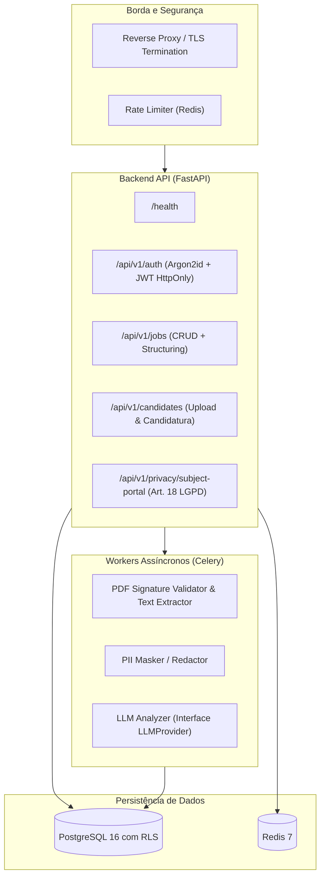

# Arquitetura e Fronteiras de Componentes

## 1. Visão Geral dos Módulos

## 2. Princípios de Isolamento
- **Multi-Tenancy:** Todas as tabelas têm coluna `tenant_id`.
- **Filtro em Camadas:** Repositórios filtram obrigatoriamente por `tenant_id`. PostgreSQL Row-Level Security (RLS) atua como segunda linha de defesa em profundidade.
- **Isolamento de Tarefas:** Workers recebem o identificador da candidatura e resolvem o tenant no contexto de execução, garantindo que logs e métricas permaneçam segregados.
