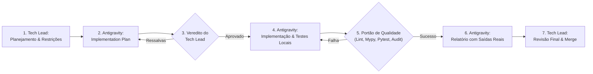

# Fluxo de Trabalho de Desenvolvimento com Agentes de IA (AI Workflow)

## 1. Princípios Metodológicos

O **TalentFlow AI** foi desenvolvido utilizando uma metodologia colaborativa entre **Humano (Tech Lead & Revisor)** e **Agente de IA (Antigravity)**.

---

## 2. Divisão de Papéis e Responsabilidades

| Atividade | Responsável | Regras e Limites |
|:---|:---:|:---|
| **Definição de Visão e Prioridades** | Tech Lead (Humano) | Define o escopo de cada fase, requisitos e restrições. |
| **Arquitetura e Vereditos** | Tech Lead (Humano) | Emite vereditos formais: Aprovado, Aprovado com ressalvas ou Reprovado. |
| **Implementação de Código e Testes** | Antigravity (IA) | Escreve código seguindo estritamente `AGENTS.md`, sem burlar linters ou tipos. |
| **Execução de Comandos no Terminal** | Antigravity (IA) | Executa verificações e apresenta a saída real sem fabricar resultados. |
| **Decisão de Merge na `main`** | Tech Lead (Humano) | Nada entra na branch principal sem revisão humana e CI verde. |

---

## 3. Registro Histórico de Revisões
Cada ciclo de revisão é registrado em `docs/reviews/` contendo:
- Veredito emitido
- Achados por severidade (Bloqueante, Importante, Sugestão)
- O que você precisa entender (para defesa em entrevistas técnicas)
- Prompt de correção ou avanço executado
